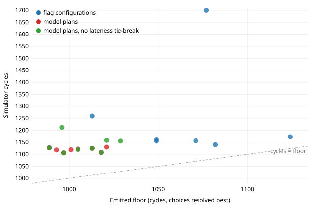

# Emission structure model: let a solver choose the kernel's structure

A small model decides how every group of 8 lanes fetches its tree node in every round
(gather, or one of three ways to select among cached nodes). It is calibrated against the real
emitter and predicts the op counts of every plan exactly. Its best plan has a capacity floor of
989 cycles against 1,049 for today's best flags. With the shaped greedy scheduler a plan from the
model runs in **1,104 cycles (1,106 on the simulator)** against 1,153 / 1,155 for today's best
flags. Every kernel here is proved equal to its SSA program, passes validation and is correct on
the unmodified upstream tests; every model plan also passes their speed thresholds (`--strict`).
The floor ignores time, so it is a good guide only while the scheduler can approach it. Here
every schedule lands 90 to 120 cycles above its floor, and two plans with the same floor can
differ by 100 cycles (section 5). Cutting vector work (section 6.1) takes it to **1,099** on the
simulator with the output unchanged (branch bits kept live), and **1,083** with `--values-only`
(indices not stored; the unmodified upstream tests pass). Estimated with the model, `vload` at
the 1-based index and subtree packets (phases 2 and 3) are worth only about 35 cycles of floor
on this structure: once loads stop binding, the vector work binds near 975 (section 6).

November 2026. Code: `scripts/emission_structure.py` (model, calibration, solve, measurement),
`solver/emission_plan.py` (plan format), `--emission-plan` (emitter). Skill:
`.cursor/skills/use-emission-structure/SKILL.md`. All numbers: 16 rounds, batch 256, height 10,
`--merge-hash-stages --index-form mirrored`, reproduced by the commands in section 9.

## 1. Two levels

| Level | Decides | Over | Tool |
|---|---|---|---|
| Structure (this model) | Which encoding each group uses for the tree access of each round | Op counts per engine; no time | CP-SAT over group counts, exact |
| Schedule (existing pipeline) | Cycle, engine and address of every op of the chosen emission | Dependencies, latency, slots, scratch | Greedy, then optionally CP-SAT |

The structure model's output is a plan file (`solver/emission_plan.py`), which
`generate_ssa_kernel.py --emission-plan PATH` emits and then schedules as usual.

## 2. Encodings

At depth `d` the node a lane needs is one of `2^d` nodes. Today's emitter has four ways to get
it, all plannable per round and per group:

| Encoding | Depths | What a group emits (relative to gathering, from the cost table, section 3) |
|---|---|---|
| `gather` | 1 to 10 | 1 vector address op (`(forest_p + L_d) - n`), 8 scalar loads, 1 XOR with the deferred hash constant |
| `bits` | 0 to 4 | `2^(d-1)` multiply_adds (leaf pairs), `2^(d-1) - 1` SelectChoices with a 2-op FMA form, bit extraction (2 per group at depth 3, 4 at depth 4) |
| `bits-flow` | 0 to 4 | As `bits`, but the leaf selects are SelectChoices with a 1-op FMA form, so all `2^d - 1` selects may go to flow |
| `mobius` | 0 to 4 | `2^d - 1` multiply_adds over Mobius coefficients, no flow |

The three bit-driven encodings come from `--cached-select` (PR #34, proofs R13 to R15).
`standard` (the default compare-and-select emission) is not plannable: each bit-driven encoding
needs fewer ops at every depth. Depth 0 is the shared root vector whatever the encoding, and depths
5 to 10 can only gather, so the choice is made in the 8 rounds at depths 1 to 4 (rounds 1 to 4
and 12 to 15).

Setup is paid once if any group uses it: the level's node loads and the node table XORed with
the hash constant (any bit-driven encoding at that level), the leaf-pair vectors (`bits`,
`bits-flow`), their `high` vectors (`bits-flow`), the Mobius coefficients (`mobius`), the level's
end-pointer constant (any `gather` at that depth) and the round's address base vector (any
`gather` in that round).

Mixing within a round is supported: `emit_round` calls each encoding's emitter once, over the
groups that use it, in the order of the first group using each. A plan that gives every group the
encoding the flags would give emits exactly the flags' SSA program
(`tests/test_emission_plan.py::test_plan_reproduces_flag_emission`), and without a plan nothing
changes (the 16-round default and `bits` builds are identical to before, op for op).

## 3. Counts from the emitter

An emission is summarised by ten counts (`emission_counts`, read from the scheduler JSON's SSA
ops after dead code elimination):

| Category | Ops | Engines it may use |
|---|---|---|
| `vec_fixed` | multiply_add, vbroadcast | VALU |
| `vec_shiftable` | other vector ops | VALU, or 8 scalar ALU slots |
| `alu` | scalar ALU ops | ALU |
| `load`, `store`, `flow` | fixed loads (`load`, `vload`), stores, flow ops other than selects | that engine |
| `select1` | SelectChoice whose FMA form is 1 multiply_add | 1 flow, or 1 VALU |
| `select2` | SelectChoice whose FMA form is SUB + multiply_add | 1 flow, or 1 fixed + 1 shiftable vector op |
| `const` / `const_alu` | ConstChoice without / with an ALU-derived form | load or flow add_imm (or 1 scalar ALU op) |

The scheduler JSON now records the FMA cost of each SelectChoice (`select_fma_vector_ops`) and
whether a ConstChoice has an ALU form (`const_alu_derivable`), so these are read, not inferred.

**Cost model.** Counts are linear in features of the plan (`plan_features`). The structure is
written by hand from reading the emitter. The coefficients are not:

| Feature | Value |
|---|---|
| `base` | 1 |
| `groups:d:e` | groups using bit-driven encoding `e` at depth `d`, over both visits (gathering groups are in `base`: per depth the counts sum to a constant) |
| `table:d`, `pairs:d`, `pairs_high:d`, `mobius:d` | 1 if the level-`d` setup of section 2 is needed |
| `gather_depth:d`, `gather_round:r` | 1 if some group gathers at depth `d` / in round `r` |
| `and:table:2+table:3`, ... (4 products) | the scalar constants 3 to 15 are derived from each other and feed the node addresses of levels 2, 3 and 4, so whether one survives dead code elimination is an OR over those levels; the products give the full multilinear form |

`calibrate` builds 144 design plans (each round and encoding alone, every subset of cached levels
with each encoding, pairs with Mobius, 40 random mixes) and solves for integer coefficients by
exact rational elimination. It raises if no exact fit exists. Without the 4 products there is
none (scalar ALU ops are not additive), which is how the coupling was found. `check` then builds
fresh random plans and compares every count:

| Shape | Design plans (exact) | Unseen random plans predicted exactly |
|---|---|---|
| 16 rounds, 32 groups | 144 | 30 of 30 |
| 16 rounds, 4 groups (the test) | 124 | 12 of 12, every run of `tests/test_emission_structure.py` |
| 16 rounds, 4 groups | 144 | 40 of 40 |

The cost table at 32 groups (`python -m scripts.emission_structure table`; empty = 0):

| Feature | vec_fixed | vec_shiftable | alu | load | select1 | select2 | const | const_alu |
|---|---|---|---|---|---|---|---|---|
| base | 2,486 | 5,056 | 104 | 3,620 | | | 47 | 6 |
| groups:1:bits / bits-flow / mobius | 1 / 0 / 1 | -2 | | -8 | 0 / 1 / 0 | | | |
| groups:2:bits / bits-flow / mobius | 2 / 0 / 3 | -2 | | -8 | 0 / 2 / 0 | 1 / 1 / 0 | | |
| groups:3:bits / bits-flow / mobius | 4 / 0 / 7 | 0 | | -8 | 0 / 4 / 0 | 3 / 3 / 0 | | |
| groups:4:bits / bits-flow / mobius | 8 / 0 / 15 | 2 | | -8 | 0 / 8 / 0 | 7 / 7 / 0 | | |
| table:1 / 2 / 3 / 4 | 1 | | 4 / 11 / 27 / 53 | 2 / 4 / 8 / 16 | | | | |
| pairs:1 / 2 / 3 / 4 | 1 / 3 / 7 / 15 | | 1 / 2 / 4 / 8 | | | | | |
| pairs_high:1 / 2 / 3 / 4 | | 1 / 2 / 4 / 8 | | | | | | |
| mobius:1 / 2 / 3 / 4 | 1 / 3 / 7 / 15 | | 1 / 4 / 12 / 32 | | | | | |
| gather_round:r (each of 8) | 1 | | 1 | | | | | |
| gather_depth:3 / 4 | | | | | | | 0 / 1 | 1 / 0 |
| and:table:2+3, 2+4, 3+4, 2+3+4 | | | -3, -3, -5, +3 | | | | | |

Stores (64) and fixed flow ops (0) are constant. Reading it: a group that selects level 4 with
`bits-flow` instead of gathering saves 8 loads and costs 8 + 7 selects and 2 vector ops (bit
extraction 4, minus the gather's 2); the level-4 table costs 16 loads and 53 + 8 scalar ops once.

### 3.1 The same table by instantiation (no probe builds)

`python -m scripts.emission_structure derive` gets the table from one emission instead of 144
fits (`scheduler_rs/src/kernel_builder/transform/`, binding `derive_tree_access_cost_table`).
The canonical program (root from the shared vector, every other round gathering) is emitted
with every bit-driven alternative of every choice site built next to its gather by the
emitter's own per-group code, on operands a structural matcher binds (rule `tree-access`;
region tags only propose where to look). Then every op gets the condition under which dead
code elimination keeps it, an OR of (round, group, encoding) choices, which reduces to the
features above: shared tables to `table:d` / `pairs:d` / `pairs_high:d` / `mobius:d`, gathers'
base vectors and level-end constants to `gather_round:r` / `gather_depth:d`, and ORs across
levels, by inclusion-exclusion, to the `and:table:*` products (the scalar constants 3 to 15
that address the cached nodes). Per-site differences to gathering give `groups:d:e` and are
checked to be the same at every site. Whether a constant is `const` or `const_alu` depends
on the constants created before it, so on emission order: every constant is checked to keep
its category whatever the lazily created level-end constants `L_d` (and its own position, for
those). Anything that does not reduce to the features is reported, never fitted. At 16 rounds the derived table equals the calibrated one entry for
entry with 4 and with 32 groups (`tests/test_emission_structure.py`, and `derive` against
`calibrate`); the Rust tests also compare its predictions with emitted programs directly.
Contexts it does not cover yet: the zero-based index (bits are matched only on the mirrored
index chain) and `--values-only` (dead index updates are per group, the `tail:*` features).

## 4. The objective: the capacity floor with choices resolved

`choice_floor(counts)` is the smallest integer `T` such that some resolution of every choice fits
in `T` cycles:

```
loads + consts left on load                  <= 2T     stores <= 2T
flow + selects on flow + consts on flow      <= T
vector ops - s                               <= 6T     (s shiftable vector ops run as 8 scalar ops)
scalar ops + consts on the ALU + 8s          <= 12T
```

Taking 2-op selects to flow first is never worse, and only the consts that do not fit on the load
engine leave it, so the search is exact; it is checked against brute force over every resolution
(`test_choice_floor_matches_brute_force`). The CP-SAT model in `solve_plan` states the same
constraints over the plan variables (groups per round and encoding, booleans for the setup
features and products) and minimises `T`. The model is small (8 rounds x 4 encodings) and solves
to proven optimality in about a second.

Differences from `scripts/schedule_report.py`'s floor: that one keeps each choice as the scheduler
resolved it. The greedy puts every ConstChoice it can on load (2,124 loads for `bits` against the
2,098 fixed), so its floor is 1,062 where the choice floor is 1,049. Both are reported.

**What the model ignores.** Dependencies and latency (a select tree and the hash chain are
serial), the shape of the schedule (no load can run before a group reaches a gathered level, and
the last rounds are the schedule's tail), scratch (the bit-driven encodings keep tables live) and
the scheduler's own choices (the greedy does not balance selects between flow and the vector ALU).

**Why the floor is still a useful proxy.** Near saturation a schedule cannot be shorter than the
floor, and a good one is not much longer: the public 880-cycle kernel lands 7 above its floor
(docs/BOUND_GAP_ANALYSIS.md section 5). Here the gap is larger (section 5), so two tie-breaks
and an optional cap steer the choice among plans with similar floors:

| Rule | Why |
|---|---|
| Fewest encodings mixed into one round | Simpler plans. Never changed a result here |
| Select work at the earliest visit of a level (`lateness`: rounds weighted by the groups that select instead of gathering) | Round 15 is the schedule's tail: nothing after it can overlap its select trees. Measured: the same floor with level 4 cached in round 15 instead of round 4 costs 30 to 100 greedy cycles |
| `--max-util flow=F` (optional): use at most a fraction F of an engine's capacity | The floor-optimal plan saturates loads and flow together, and the greedy cannot pack both. The cap minimises `T` under the cap and reports the plan's own floor too |

## 5. Results

Shaped greedy (`--greedy-barriers none --greedy-priority wavefront --greedy-split-shift
--pressure-inflation-threshold 0.95`). "Predicted floor" is `choice_floor` of the model's counts,
"emitted floor" the same of the built kernel's counts, "scheduled floor" `schedule_report`'s floor
with the scheduler's own resolution (binding engine in brackets). Every row: counts predicted
exactly, PROVED (dataflow replay), PASSED (values and indices), and correct on the unmodified
upstream tests (`./scripts/check_upstream.sh`). Every row also passes the upstream speed
thresholds (`--strict`) except `bits-flow` with level 4 on both visits, at 1,700 cycles.

| Structure | Predicted floor | Emitted floor | Scheduled floor | Cycles (sched / sim) | Peak live |
|---|---|---|---|---|---|
| flags `--cached-select bits` (today's best) | 1,049 | 1,049 | 1,062 (load) | 1,153 / 1,155 | 771 |
| flags `bits-flow` | 1,049 | 1,049 | 1,067 (load) | 1,160 / 1,162 | 771 |
| flags `mobius` | 1,071 | 1,071 | 1,071 (ALUs) | 1,154 / 1,156 | 771 |
| flags `bits`, level 4 after the wrap | 1,082 | 1,082 | 1,082 (ALUs) | 1,138 / 1,140 | 915 |
| flags `bits-flow`, level 4 after the wrap | 1,013 | 1,013 | 1,204 (flow) | 1,257 / 1,259 | 1,035 |
| flags `bits`, level 4 on both visits | 1,124 | 1,124 | 1,124 (ALUs) | 1,171 / 1,173 | 930 |
| flags `bits-flow`, level 4 on both visits | 1,077 | 1,077 | 1,685 (flow) | 1,698 / 1,700 | 1,043 |
| model, floor-optimal (`docs/emission_plans/floor_optimal.json`) | **989** | 989 | 1,007 (load) | 1,125 / 1,127 | 1,027 |
| model, `--max-util flow=0.9` (`docs/emission_plans/flow90.json`) | 997 | 997 | 1,014 (load) | **1,104 / 1,106** | 1,049 |

The two model plans:

| Plan | Rounds 0 to 3 | Round 4 | Rounds 11 to 14 | Round 15 |
|---|---|---|---|---|
| floor-optimal | bits, then bits-flow x3 | 15 gather + 17 bits-flow | bits, then bits-flow x3 | gather |
| flow 0.9 | bits x2, bits-flow x2 | 17 gather + 15 bits-flow | bits x2, bits-flow x2 | gather |

Both cache level 4 in only some groups of one visit, the per-group mix that design C1 of
docs/BOUND_GAP_ANALYSIS.md section 5 predicted.

Sweep of the flow cap (`sweep`, same scheduler flags; all rows PROVED and PASSED, the
tie-break rows also upstream `--strict`). Simulator cycles:

| Cap | none | flow 0.95 | 0.9 | 0.85 | 0.8 | 0.7 | 0.6 | 0.5 | load 0.97 | load 0.95 + flow 0.8 |
|---|---|---|---|---|---|---|---|---|---|---|
| Plan floor | 989 | 993 | 997 | 1,001 | 1,005 | 1,013 | 1,021 | 1,029 | 996 | 1,018 |
| With the lateness tie-break | 1,127 | 1,118 | **1,106** | 1,119 | 1,122 | 1,125 | 1,130 | | | 1,108 |
| Without it (`--no-lateness`) | 1,127 | | 1,106 | | 1,120 | 1,125 | 1,158 | 1,155 | 1,212 | 1,108 |

Without the tie-break the solver is free to put the level-4 selects in round 15 instead of
round 4 (same floor): the flow 0.6, 0.5 and load 0.97 plans do so and lose 30 to 100 cycles.

Floor against cycles for every build above (`scatter`; dashed: cycles = floor):



The flag configurations spread along the floor axis with cycles barely moving (1,140 to 1,175,
outliers where the greedy puts every select on flow); the model's plans sit 60 floor cycles
lower and 30 to 50 cycles faster, about 100 to 140 above their floors.

What the numbers say:

- **The model is exact on counts and floors**: predicted = emitted in every build (several hundred
  plans across calibration, checks and these tables).
- **It finds better structures than the flags**: the floor falls from 1,049 to 989 (-60), and
  cycles from 1,153 to 1,104 (-49). The flag combination `bits` + level 4 after the wrap, which
  docs/EMISSION_ABLATION.md measured only with the default greedy (2,357 cycles), already gives
  1,138 here. The model's plan is 34 better still.
- **The floor ranks plans only roughly once loads bind**: plans with floors 989 to 1,021 all land
  at 1,104 to 1,128, and the order is not the floor's order. Before the lateness tie-break, plans
  with the same floors put the level-4 selects in round 15 and ran at 1,153 to 1,212.
- **The gap is the scheduler's**: 91 above the floor for `bits`, 107 for the best plan. The greedy
  resolution alone accounts for 13 to 17 (consts on load: "scheduled floor" against "emitted
  floor").

**Where the gap goes** (`scripts.schedule_report` on the 1,104-cycle schedule of `flow90.json`):
the vector ALU is 100% busy from cycle 111 to about 994 and the loads nearly so, but the greedy
ran only 1,039 vector ops as 8 scalar ops, while the floor's balance needs about 1,465. The scalar
ALU is 64% used. The vector ALU's own term is then 6,387 / 6 = 1,065, only 39 below the schedule.
So most of the gap is the greedy's VALU-to-ALU shifting (roughly 50 to 70 cycles), and the rest is
ramp-up and tail (the first and last tenth run at 72% to 93% on the vector ALU, 47% to 75% on loads).
This is recorded to keep the gap measured; scheduler work is out of scope here.

CP-SAT on the best plan: section 5.1.

### 5.1 CP-SAT

One 16-round run on `flow90.json` with the shaped flags and `--cpsat-deterministic-time 300`
(wall-clock backstop 7,200 s, on a shared and heavily loaded machine): **1,132 schedule / 1,134
simulator cycles**, PROVED and PASSED, best bound 1,000. It stopped on the wall-clock backstop
after 172 of the 300 deterministic-time units, so it is not reproducible, and it did not improve
its warm start. That warm start is worse than the greedy's own 1,104 because the greedy split
shift is not used when CP-SAT follows the greedy. CP-SAT at 3 rounds through the same emission
paths is covered by docs/EMISSION_ABLATION.md section 3.4.

## 6. Phases 2 and 3: what the model says they are worth

The model takes new encodings as rows of the cost table once the emitter has them. Before
building one, `--what-if` gives an uncalibrated estimate with hand-adjusted coefficients:

| What-if (not calibrated) | Floor-optimal plan | Binds |
|---|---|---|
| Today's encodings (calibrated) | 989 | loads |
| `gather-without-address-op`: every gather loses its vector address op, as `vload` at the 1-based index would (phase 2) | 971 | loads and ALUs |
| `packets-5`: levels 5+6 from one per-lane `vload` of a 3-word packet (phase 3, one pair) | 981 | ALUs |
| `packets-5-7`: levels 5+6 and 7+8 | 996 | ALUs |
| `packets-5-7-9`: levels 5 to 10 | 1,054 | ALUs |
| phase 2 + `packets-5` (the packet estimate removes the address ops again, so about 8 too low) | 947 | ALUs |

The packet estimate per group and level pair (`what_if_packets`): 8 loads instead of 16; one
multiply_add for the packet address instead of 2 address ops and 2 constant XORs; 8 scalar copies
of the node word into the group vector and 16 scalar ops for the child (`left + bit * diff`).
Setup per pair at level L: `3 * 2^L / 8` vloads and vector XORs, `2^L` scalar subtracts, and
`3 * 2^L` scalar stores with their address adds, on the otherwise idle store engine. The setup
grows as `2^L`, which is why deeper pairs make it worse.

**Why packets pay little here.** As soon as loads stop binding, the ALUs do. The best plan's
7,452 vector-op equivalents are 14.55 per group-round:

| Phase | Vector-op equivalents | Per group-round |
|---|---|---|
| Hash | 5,120 | 10.00 |
| Branch bit and index update | 896 | 1.75 |
| Tree access (addresses, constant XOR, selects not on flow, bit extraction) | 743 | 1.45 |
| Node XOR | 512 | 1.00 |
| Setup, input and output | 181 | 0.35 |

That alone is a floor of about 975 whatever the load count. The public 880-cycle kernel does
all of its non-hash work in 2.58 per group-round (docs/BOUND_GAP_ANALYSIS.md section 3); here it
is 4.55. That difference (about 1,000 equivalents, 135 cycles) is the larger part of its
advantage, so a packet encoding pays only together with cheaper index, address and XOR work.
Phase 2 and phase 3 together are worth about 35 cycles of floor on this structure, less than the
scheduler's 107-cycle gap on the current best plan.

Leads from the leaderboard research, to verify:

| Lead | Mechanism | In this model |
|---|---|---|
| 899 cycles | 3-word two-level packets, 6 loads per lane, no address add | The `packets-*` what-ifs above; with this structure's vector work it does not reach the load floor |
| 913 cycles | Per-lane `jump_indirect` dispatch reading depth-4 nodes from scratch: rounds 4 and 15 need no gathers | Needs control flow in a straight-line scheduled kernel, which the pipeline does not have |
| 982 cycles | Level-4 caching for a searched subset of groups | What this model does (section 5) |
| Estimate | 899-style packets for levels 4 to 7: about -480 loads, load floor about 822 | The load floor falls, but the ALUs bind near 975 first |

### 6.1 Cutting vector work (the direction taken)

The user chose to cut vector work rather than build packets or work on the scheduler. Four
candidates, cheapest to verify first:

| Candidate | Result | Evidence |
|---|---|---|
| Address-free gather by `vload` at a pointer-form index (phase 2) | **Impossible at the same op count.** A `vload` at `p = idx + F` leaves `tree[idx]` in a fixed word for any `F = forest_p - w`, but the true branch bit is `1 - (lazy & 1)`, so the update `p' = 2p + bit + 1 - F` needs one op giving `(2 - F) - (v & 1)`. No single ISA op with a constant does, for any `F` from 1 to 8 and either operand order. The update stays 3 ops, which costs the address op back in every round | Z3, `scripts/analyze_bound_gap.py --z3` ("NO SUCH OP") |
| Fold the node XOR into hash stage 0 | **No fold exists.** It would need `(x ^ y) * 4097 + C0` to be affine in the value `x` and the node `y`; no constants make it so | Z3, same script ("NO SUCH FOLD") |
| Skip index updates nothing reads | Only with `--values-only`: otherwise the final index store reads the whole chain. With it, a group's updates after its last index read are dead, and which ones depends on the group's own gather/select pattern over rounds 12 to 15, so the cost model gains `tail:<pattern>` features (exact: 144 design plans and every unseen plan) | `tests/test_emission_structure.py::test_values_only_tail_patterns_make_the_fit_exact` |
| Branch bits kept live instead of extracted (`--select-bit-source path`) | No bit-extraction ops at depths 3 and 4. Fits the scratch budget under the wavefront for the solved plans; some calibration plans do not build and are skipped | Calibration notes; the rows below |

`--values-only` changes the output (indices not stored) and is allowed in recorded results when
the unmodified upstream tests pass; every values-only number below says so.

Solved and measured (shaped greedy; every row counts predicted exactly, PROVED, PASSED, and
`./scripts/check_upstream.sh --strict` passes; values-only rows are validated on values only):

| Context | Cap | Plan floor | Cycles (sched / sim) | Level-4 selects |
|---|---|---|---|---|
| merge + mirrored (section 5) | flow 0.9 | 997 | 1,104 / 1,106 | round 4, 15 groups |
| + `--select-bit-source path` | none | 973 | 1,107 / 1,109 | round 4, 21 groups |
| + `--select-bit-source path` | **flow 0.9** | 980 | **1,097 / 1,099** | round 4, 20 groups |
| + `--select-bit-source path` | flow 0.8 | 989 | 1,103 / 1,105 | round 4, 17 groups |
| + `--values-only` (values only) | none | 980 | 1,200 / 1,202 | round 15, 20 groups |
| + `--values-only` (values only) | flow 0.9 | 985 | 1,196 / 1,198 | round 15, 18 groups |
| + `--values-only` (values only) | flow 0.8 | 995 | 1,137 / 1,139 | round 15, 16 groups |
| + both (values only) | none | 957 | 1,157 / 1,159 | round 15, 25 groups |
| + both (values only) | flow 0.9 | 965 | 1,107 / 1,109 | round 15, 23 groups |
| + both (values only) | flow 0.8 | 973 | 1,112 / 1,114 | round 15, 21 groups |
| + `--values-only`, `--fix 15=gather` (values only) | none | 981 | 1,120 / 1,122 | round 4, 19 groups |
| + `--values-only`, `--fix 15=gather` (values only) | flow 0.9 | 989 | 1,095 / 1,097 | round 4, 17 groups |
| + `--values-only`, `--fix 15=gather` (values only) | flow 0.8 | 997 | 1,109 / 1,111 | round 4, 15 groups |
| + both, `--fix 15=gather` (values only) | none | 964 | 1,086 / 1,088 | round 4, 24 groups |
| + both, `--fix 15=gather` (values only) | **flow 0.9** | 969 | **1,081 / 1,083** | round 4, 22 groups |
| + both, `--fix 15=gather` (values only) | flow 0.8 | 977 | 1,084 / 1,086 | round 4, 20 groups |

What this says:

- Path bits are worth 7 cycles measured (1,106 to 1,099) and 9 to 16 of floor, with the output
  unchanged.
- Values-only lowers the floor (989 to 980 alone, 957 with path bits) but the measured cycles get
  worse, because it makes level-4 selects in round 15 cheaper in ops: a group that selects there
  needs no index update in rounds 14 and 15. The floor then prefers round 15, the schedule's tail,
  and the lateness tie-break never applies (the floors differ). This is the model's known limit
  (section 7) showing up in the opposite direction: an op-count saving that costs time.
- Keeping the last round free of select work (`--fix 15=gather`, a constraint on the plan rather
  than a tie-break) recovers it: values-only with path bits reaches **1,081 / 1,083** (floor 969),
  values-only alone 1,095 / 1,097. Under every cap, the fixed plans beat the unfixed ones by 15 to
  100 cycles.
- Best plans, both checked in: `docs/emission_plans/path_flow90.json` (output unchanged, 1,099 on
  the simulator) and `docs/emission_plans/values_only_path_fix15_flow90.json` (values only, 1,083).


| Limit | Consequence | Mitigation here |
|---|---|---|
| No time: the floor counts slots, not when work can run | Plans with equal floors schedule up to 100 cycles apart; the floor ranks plans only roughly once loads bind | Measure every candidate; `sweep` over caps |
| Symmetric between visits of a level | Cannot tell round 4 from round 15, though round 15 is the tail | Lateness tie-break (select work at the earliest visit), a heuristic justified by the measurements above, not part of the floor |
| No scheduler model | The greedy keeps consts on load and does not balance selects between flow and the vector ALU | `--max-util` headroom on flow; report the scheduled floor beside the emitted one |
| Cost model structure is hand-written | A new encoding with new shared resources needs new features | `calibrate` fails loudly on any inexact fit; `check` on unseen plans |
| Group assignment within a round | Contiguous runs in a fixed order | Not explored |

## 8. What was not verified

| Item | State |
|---|---|
| CP-SAT at 16 rounds on the model's plans | See section 5.1 |
| Which groups get which encoding within a round | The plan gives each encoding a contiguous run of groups in a fixed order; other assignments (e.g. interleaved with the wavefront's stagger) were not tried |
| `--values-only`, the zero-based index, `--select-bit-source path` | Supported as contexts (separate calibration); not measured here. The zero-based form is covered by a PROVED and PASSED test |
| Calibration at other shapes than 16 rounds with 4 and 32 groups | Not run |
| The what-if of section 6 | An estimate by construction; no emitter exists for it yet |

## 9. Reproduction

```bash
./scripts/build_scheduler_rs.sh --release
M="uv run python -m scripts.emission_structure"
$M calibrate                                   # 144 builds, about 2 minutes; exact or an error
$M check --plans 30 --seed 99                  # unseen random plans: predicted == emitted
$M table                                       # section 3
$M predict                                     # floors of the flag configurations
$M solve --out docs/emission_plans/floor_optimal.json
$M solve --max-util flow=0.9 --out docs/emission_plans/flow90.json
$M measure --shaped --upstream --plan bits --plan bits-flow --plan mobius --plan bits+depth4-after-wrap \
  --plan bits-flow+depth4-after-wrap --plan bits+depth4 --plan bits-flow+depth4 \
  --plan docs/emission_plans/floor_optimal.json \
  --plan docs/emission_plans/flow90.json                                       # section 5, first table
$M sweep --shaped --upstream --max-util none --max-util flow=0.95 --max-util flow=0.9 --max-util flow=0.85 \
  --max-util flow=0.8 --max-util flow=0.7 --max-util flow=0.6 --max-util load=0.95,flow=0.8 --json sweep.json
$M sweep --shaped --no-lateness --max-util none --max-util flow=0.9 --max-util flow=0.8 --max-util flow=0.7 \
  --max-util flow=0.6 --max-util flow=0.5 --max-util load=0.97 --max-util load=0.95,flow=0.8 --json nolate.json
$M measure --shaped --json flags.json --plan bits --plan bits-flow --plan mobius --plan bits+depth4-after-wrap \
  --plan bits-flow+depth4-after-wrap --plan bits+depth4 --plan bits-flow+depth4
$M scatter --input "flag configurations=flags.json" --input "model plans=sweep.json" \
  --input "model plans, no lateness tie-break=nolate.json" --out docs/emission_plans/floor_vs_cycles.svg
$M sweep --shaped --upstream --select-bit-source path --max-util none --max-util flow=0.9 \
  --max-util flow=0.8                                                         # section 6.1
$M sweep --shaped --upstream --values-only --select-bit-source path --fix 15=gather --max-util none \
  --max-util flow=0.9 --max-util flow=0.8                                     # (also without --fix,
                                                                              # and without path)
uv run --extra verify python scripts/analyze_bound_gap.py --z3 --json sched.json  # the two Z3 negatives
$M solve --what-if gather-without-address-op                                 # section 6, also packets-5,
                                                                              # packets-5-7, packets-5-7-9

# One plan by hand
uv run generate_ssa_kernel.py --rounds 16 --use-greedy --validate --merge-hash-stages --index-form mirrored \
  --emission-plan docs/emission_plans/flow90.json \
  --greedy-barriers none --greedy-priority wavefront --greedy-split-shift --pressure-inflation-threshold 0.95
```
